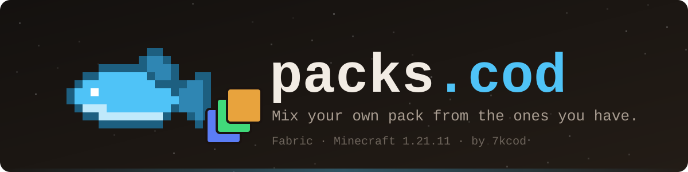

<p align="center">
  
</p>

<p align="center">
  
  
  
  
  
</p>

<p align="center">
  <b>Mix your own resource pack from the ones you already have.</b><br>
  Pick every texture, model and sound from any pack, see it in game, then export a normal
  <code>.zip</code> your friends can use <b>without</b> the mod.
</p>

<p align="center">
  <a href="#features">Features</a> ·
  <a href="https://github.com/7kcod/Packs.cod/releases/latest"><b>⬇ Download</b></a> ·
  <a href="#install">Install</a> ·
  <a href="#using-it">Using it</a> ·
  <a href="#building">Building</a> ·
  <a href="CHANGELOG.md">Changelog</a>
</p>

---

> The mod's in-game name is **pack.cod**; this repo is **packs.cod**.
> It's also built into **[client.cod](../../../client.cod)**.

## Features

### 🧺 The mixer
- **Categories** that fold out: PvP (swords, hearts, tools, UI, crosshair, armor, shield, pots, hit effects, breaking, totem), kits, sky, natural, ores & gems, mobs, sounds, models and more
- **Grid** and **Board** views, and an item page with **every pack's version side by side**
- **Brush** a pack, **Fill**, **Reset**, **Only brush**, **Surprise me**
- **Grouped sets** swap together: hearts, crosshair, shield, sky, end crystal, every side of a block, particle frames, all 10 breaking stages
- **Star** favourite packs, filter by **resolution**

### 👀 Previews
| View | Shows |
|---|---|
| Flat · Block | The texture, or a 3D block |
| World | The block placed in a little scene |
| In game | A real first-person view with the pack's HUD, using your own screenshots as backgrounds |
| On player | Armor on a player |
| 3D mobs | Zombies, skeletons, creepers, player skins |
| Animations | Totem pop, hit particles, block breaking with the pack's pickaxe |
| Sounds | Click to hear every pack's version |

### ✏️ Draw
Pixel editor, image converter (resize, crop, move, opacity, palette) and recolour (hue, saturation, brightness).
Edits go into a **pack.cod edits** pack, so they mix and export like any pack.

### 📦 Mixes & export
- Save as many **mixes** as you want; share them with **mix codes**
- **Live**: your mix goes on in game when you leave pack.cod · **Try in game**
- Export with a name, colour and icon; it shows the size and warns about mixed resolutions

### 🌐 Browse
The 50 most downloaded packs on PacksMC. **Get** opens the pack on packsmc.com, and pack.cod
offers to install it once it lands in your Downloads folder.

### 🎨 Look
8 palettes (Cod, Deep Ocean, Nether, The End, Emerald, Snow, Midnight, Cherry), any accent,
and 5 styles (Classic, Pixel, Flat, Outline, Glow). client.cod uses the same look.

## Install

1. Install [Fabric Loader](https://fabricmc.net/use/) for **1.21.11** and [Fabric API](https://modrinth.com/mod/fabric-api).
2. Download `pack-cod-<version>.jar` from **[Releases](https://github.com/7kcod/Packs.cod/releases/latest)** and put it in your `mods` folder.
3. Using client.cod? Then you **don't** need this jar: pack.cod is already inside it.

## Using it

- Click the **cod** (top left) on the title screen or Resource Packs screen, or type `/packcod` in a world
  (that also saves a clean screenshot as a preview background).
- Pick a category, click an item to see every pack's version, click one to use it.
- **Export** puts the zip in your `resourcepacks` folder.

Your work autosaves to `config/packcod/`.

## Building

```bash
git clone https://github.com/<you>/packs.cod
cd packs.cod
./gradlew build          # Windows: gradlew.bat build
```

The jar ends up in `build/libs/`. Needs **Java 21**. `TEST.bat` starts a dev copy of Minecraft
with the mod loaded; `BUILD.bat` builds and copies the jar into a Modrinth profile's `mods` folder.

### Project layout

```
src/main/java/dev/cod/packcod/
├── PackCodClient.java   entry point, title button, /packcod
├── pack/                categories, pack library, mixes, exporter, settings, PacksMC
└── ui/                  mixer, previews, first-person renderer, pixel editor, export, look, browse
```

## Changelog

See **[CHANGELOG.md](CHANGELOG.md)**. Every update gets a new `0.x` version.

## Credits

Made by **7kcod** 🇧🇾 (solo dev)

Built by 7kcod

If you share a pack you mixed, credit the original pack authors and respect their licences
(every export includes a `credits.txt`). Pack list from [PacksMC](https://packsmc.com).
Not affiliated with Mojang or PacksMC.

## License

[MIT](LICENSE)
